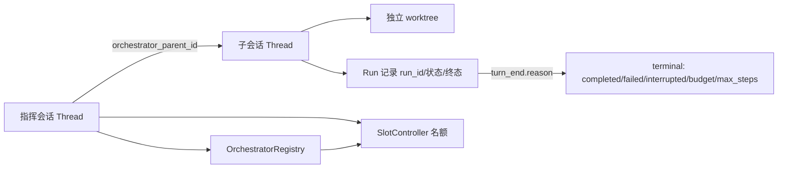
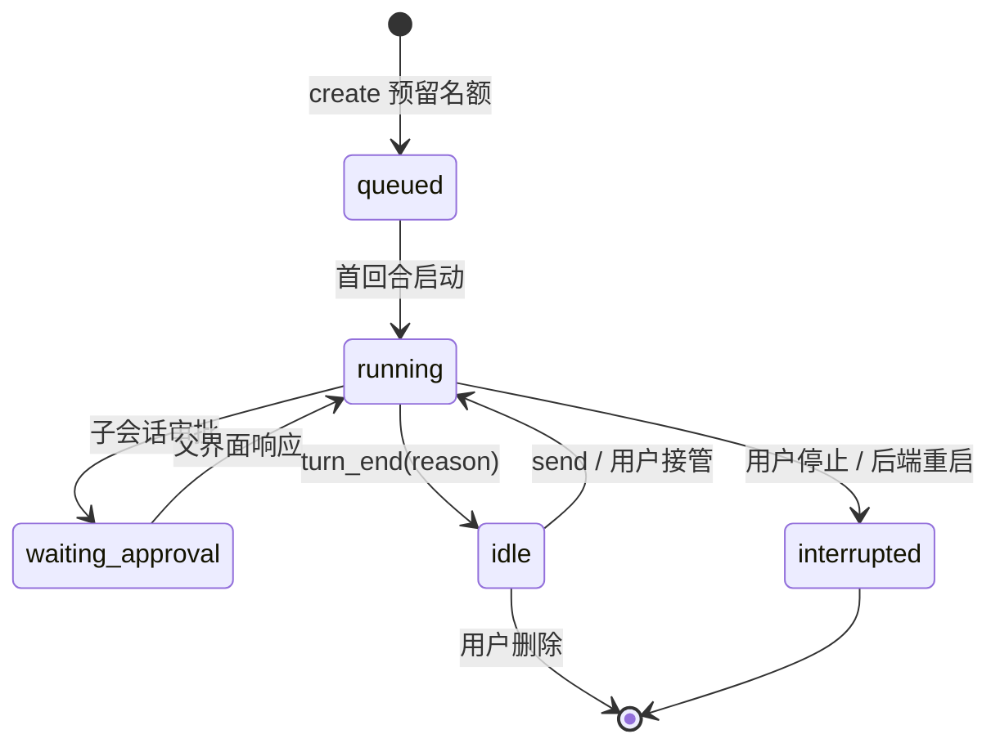

# D6-1 指挥会话：文件级实施任务书

> 2026-10-28 编写。上游方案见 2026-10-28-stabilization-and-d6.md 的「Wave 3」。
> 那份文档给的是设计决策（10 条），本文把它拆成可执行单元：改哪个文件的哪个函数、先写哪个失败测试、用什么命令验证。
>
> **本文不是实施**。每个单元开始前仍需一次 RED → GREEN 循环；没有跑出红灯的单元不允许直接写实现。

## 这份文档解决什么

原计划 Wave 3 的缺口：T7/T8 只有设计意图，没有文件清单和失败测试。照文档直接写代码会变成"边写边设计"，D6-1 又是本项目最大的一次关系模型改动，返工成本高。

本文把 D6-1 拆成 **9 个单元、3 个波次**。每波结束跑该波验证命令；跨波不并行。

## 不变量（安全清单，实现时逐条对照）

违反任意一条即视为缺陷，不是"以后再补"：

| # | 不变量 | 违反后果 |
|---|---|---|
| I1 | 控制关系只能由服务端从可信 Session 身份写入，模型参数不能伪造 parent | 任意会话可被他人的子会话操纵 |
| I2 | 子会话的有效能力 ≤ 父会话有效能力（权限模式、deny/ask、沙箱、网络、预算） | 通过子会话绕过父会话的只读/预算/沙箱 |
| I3 | 写型子会话必须在独立 worktree；共享 cwd 只允许只读 | 隔离失败退化成直接改主目录（T5 已修的同族问题） |
| I4 | `idle` 不等于成功；终态必须由 `turn_end.reason` 决定 | 用户看到"完成"但实际 error/interrupted |
| I5 | 并发名额在发起运行时预留，create 与 send 共用同一控制器 | 先建空闲子会话再同时 send，绕过上限 |
| I6 | 删除父会话不级联删除子会话的 worktree 与成果 | 未合并的代码被一起删掉 |
| I7 | 重启后不自动重放请求或审批 | 重复执行有副作用的操作 |
| I8 | 工具只对 full 且用户显式启用的新会话注入，前缀缓存不被热改 | 破坏缓存、每会话多付固定 token |
| I9 | 查询类工具（status/list）不得修改 Git 索引或用户文件 | T3 刚修过的同类缺陷 |

## 数据与状态





关键区分：**`Thread.status`（交互态）** 与 **Run 的 `terminal_reason`（结果）** 是两份数据。前者来自 `ee\ee\server\threads.py:193`，后者需要新增持久字段。

## Wave A：数据模型与核心服务（不涉及工具与界面）

### U1 关系字段与元数据

**改**
- `ee\ee\server\threads.py:81`（`meta` 初始化）与 `:200` `summary()`：输出 `orchestrator_parent_id`、`orchestrator_role`、`run` 摘要
- `desktop\src\types.ts:103` `ThreadSummary`：同步可选字段

**先写测试** `ee\tests\test_orchestrator_model.py`
- `test_summary_exposes_orchestrator_fields`：meta 带 `orchestrator_parent_id` 时 summary 能读出；没有时字段为 `None`（不误用 `parent_id`）
- `test_fork_parent_id_is_not_orchestrator_relation`：用 `server\branch.py` 的 fork 造一个 `parent_id` 会话，断言 `orchestrator_parent_id is None`
- `test_relation_survives_restart`：写入 meta → 新建 Backend → `thread/get` 读回一致

**判据**：普通 fork 与受控子会话在数据层可区分；重启后可恢复。

### U2 Run 记录与终态

**改**
- `ee\ee\server\threads.py:275` `start_turn` 增加 run 元数据（`run_id`、`started`、`initiator`）
- `ee\ee\server\threads.py` `_finish()`：把 `reason` 写入该 run 的 `terminal_reason`，持久化到 meta
- 新增 `ee\ee\core\orchestrator_model.py`：`RunRecord` dataclass + 序列化（纯数据，无 IO）

**先写测试** `test_orchestrator_model.py`
- `test_idle_is_not_completed`：回合以 `interrupted` 结束时，run 的 `terminal_reason` 是 `interrupted`，`status` 回到 `idle`
- `test_terminal_reason_persists`：重启后 run 记录仍在，且 `terminal_reason` 不被覆盖
- `test_run_ids_are_unique_per_dispatch`：同一子会话连续两次 send 得到两个 run_id

**判据**：能从持久数据回答"这个子任务成功了吗"，而不是看 `status`。

### U3 名额控制器

**改**
- 新增 `ee\ee\core\orchestrator_slots.py`：`SlotController`（进程内、按父会话隔离）
- 配置 `ee\ee\config.py` `DEFAULTS` 增加 `"orchestrator": {"enabled": False, "max_children": 4, "max_total_children": 16}`
- `ee\ee\config.py` `sanitize_project_layer`：项目层只能关、只能调小（与 sandbox/budget 同一写法）

**先写测试** `ee\tests\test_orchestrator_slots.py`
- `test_reserve_then_release`：预留后数量增加，释放后回落
- `test_over_limit_raises`：超过 `max_children` 抛错并说明上限
- `test_concurrent_reserve_is_atomic`：`asyncio.gather` 并发 10 次预留，成功数恰好等于上限
- `test_total_children_limit`：已存在的子会话（含 idle）超过 `max_total_children` 时拒绝新建
- `test_project_can_only_tighten`：项目把 4 改成 99 → 仍是 4；改成 1 → 生效

**判据**：create 与 send 走同一个 `reserve()`，没有第二条绕过路径。

### U4 能力继承

**改**
- 新增 `ee\ee\core\orchestrator_cap.py`：`child_capability(parent_session, requested) -> dict`，把父会话有效策略降级成子会话上限
- `ee\ee\core\subagent.py` 的 `access()` / 构造 `PermissionPolicy` 的写法（约 `:340–380`）作为参照，不直接复用

**先写测试** `ee\tests\test_orchestrator_cap.py`
- `test_child_mode_never_wider`：父 `read-only` → 子请求 `auto` 得到 `read-only`
- `test_deny_rules_are_inherited`：父 `deny=["shell(rm *)"]` → 子的有效 deny 含同一规则
- `test_sandbox_and_network_follow_parent`：父只读默认沙箱开、禁网 → 子继承
- `test_budget_root_is_parent`：子会话的预算根指向父，不新建独立账本
- `test_shared_cwd_requires_readonly`：请求共享 cwd 且非只读 → 拒绝并给出原因

**判据**：I2、I3 有测试钉住，而不是靠注释。

## Wave B：五个工具与审批冒泡

### U5 窄接口 + 三个读工具

**改**
- 新增 `ee\ee\core\orchestrator.py`：`OrchestratorAPI` Protocol（只暴露 `list_children` / `status` / `wait` / `create_child` / `send`）
- 新增 `ee\ee\server\orchestrator.py`：实现（持有 Backend 引用，但只通过 Protocol 形状暴露）
- 新增 `ee\ee\tools\orchestrate.py`：`ThreadsListTool`、`ThreadStatusTool`、`ThreadWaitTool`
- `ee\ee\tools\__init__.py:30` `build_tools`：注入编排工具（仅在 `orchestrator.enabled` 且 `agent == "full"`）
- `ee\ee\core\session.py` `_guarded_run` 的 `ToolContext.extra`（约 `:1221`）增加 `"orchestrator"` 句柄

**先写测试** `ee\tests\test_orchestrator_tools.py`
- `test_tools_absent_by_default`：默认 `build_tools("full", cfg)` 不含 `thread_*`
- `test_tools_present_when_enabled`：启用后五个工具都在
- `test_lean_never_gets_orchestrator_tools`：`build_tools("full", cfg, agent="lean")` 不含
- `test_status_does_not_touch_index`：对带未跟踪文件的 worktree 调 `thread_status`，`git ls-files -s` 前后一致（复用 T3 的断言方式）
- `test_list_discovers_children_after_restart`：清空 `backend.threads` 后 `threads_list` 仍能列出子会话
- `test_wait_returns_terminal_reason`：子会话以 `budget` 结束时，wait 结果标注 `budget` 而不是 `idle`

**判据**：I9（查询不改索引）、I8（lean/默认不注入）、重启可发现。

### U6 写工具 + 审批冒泡

**改**
- `ee\ee\tools\orchestrate.py`：`ThreadCreateTool`、`ThreadSendTool`
- `ee\ee\server\orchestrator.py`：`create_child` 走 `reserve()` → `worktree.create_for_agent` → `thread_start` → 写 `orchestrator_parent_id`
- `ee\ee\server\app.py:81` methods 表附近：注册 `thread/child_approval` 通知所需的路由（转发审批）
- `ee\ee\server\threads.py` `_on_event` 的 `ApprovalRequest` 分支：子会话审批同时通知父会话

**先写测试** `ee\tests\test_orchestrator_flow.py`
- `test_create_child_creates_worktree_and_parent`：`orchestrator_parent_id` 正确、worktree 分支以 `ee/` 开头
- `test_create_without_worktree_only_readonly`：`worktree=false` + 非只读 → 拒绝
- `test_send_uses_slot`：名额已满时 send 被拒（不是只有 create 受限）
- `test_child_approval_reaches_parent`：子会话触发审批 → 父会话收到 `thread/child_approval`
- `test_respond_from_parent_completes_child`：从父会话 `approval/respond`（thread_id 为子会话）→ 子会话继续
- `test_duplicate_respond_is_rejected`：重复响应返回明确错误，不崩溃
- `test_child_cannot_create_grandchild`：子会话工具表里没有 `thread_create`

**判据**：I1、I5 有测试；审批链路端到端走通（假模型，不启真实模型）。

### U7 重启与删除语义

**改**
- `ee\ee\server\app.py` `thread_delete`：父会话删除时把子会话的 `orchestrator_parent_id` 置空（不级联删 worktree）
- `ee\ee\server\orchestrator.py`：启动时不自动恢复运行，只把遗留 `running` run 标为 `interrupted`
- `ee\ee\server\threads.py`：run 的 `terminal_reason` 在重启路径上写 `interrupted`

**先写测试** `test_orchestrator_flow.py`
- `test_parent_delete_keeps_child_worktree`：删除父会话后，子会话仍在、worktree 目录与分支还在，`orchestrator_parent_id` 为空
- `test_restart_marks_running_as_interrupted`：模拟遗留 running 记录 → 新 Backend 启动后为 `interrupted`
- `test_restart_does_not_replay_turns`：重启后子会话不会自动再跑一回合

**判据**：I6、I7 有测试。

## Wave C：桌面端与端到端

### U8 左栏树形与子会话卡片

**改**
- `desktop\src\components\Sidebar.tsx:31` `ThreadRow` 与 `:307` 列表渲染：按 `orchestrator_parent_id` 缩进分组
- 新增 `desktop\src\components\ChildThreadCard.tsx`：状态点、终态原因、分支、改动数、「打开」「查看 diff」
- `desktop\src\lib\store.ts` `onNotification`：处理 `thread/child_approval`
- `desktop\src\lib\reduce.ts`：把子会话状态归并进父会话卡片

**先写测试**
- `desktop\src\components\Sidebar.test.tsx`：有 orchestrator_parent_id 的会话缩进；普通 fork 不缩进
- 新增 `desktop\src\components\ChildThreadCard.test.tsx`：`idle + terminal_reason=budget` 显示为"超预算停止"而不是"完成"
- `desktop\src\lib\store.test.ts`：`thread/child_approval` 到达后卡片进入待审批态

**判据**：用户能从父会话看到"哪个子任务失败/超预算"，不是只看"空闲"。

### U9 假模型端到端

**改**
- `ee\scripts\e2e_ws.py`：增加一段 `thread_create → thread_wait → 校验终态` 的脚本

**验证**
- `python ee/scripts/e2e_ws.py python -m ee serve --exit-on-stdin-eof` 输出"通过"
- 该场景必须覆盖：创建子会话、子会话跑一回合、wait 返回 terminal_reason

## 分波验证命令

每波结束、进入下一波前执行。命令从仓库根目录跑，依赖已安装（本机 `.venv`）：

```bash
# Wave A
./.venv/Scripts/python.exe -m pytest -c ee/pyproject.toml -q \
  ee/tests/test_orchestrator_model.py ee/tests/test_orchestrator_slots.py ee/tests/test_orchestrator_cap.py

# Wave B
./.venv/Scripts/python.exe -m pytest -c ee/pyproject.toml -q \
  ee/tests/test_orchestrator_tools.py ee/tests/test_orchestrator_flow.py \
  ee/tests/test_subagent_parallel.py ee/tests/test_queue.py ee/tests/test_rpc_contract.py

# Wave C
npm --prefix desktop run test -- Sidebar.test.tsx ChildThreadCard.test.tsx store.test.ts reduce.test.ts
cd desktop && ./node_modules/.bin/tsc.cmd -p tsconfig.json --noEmit
python ee/scripts/e2e_ws.py python -m ee serve --exit-on-stdin-eof
```

跨波回归（Wave C 末尾一次）：
```bash
./.venv/Scripts/python.exe -m pytest -c ee/pyproject.toml -q \
  ee/tests/test_server.py ee/tests/test_server_audit.py ee/tests/test_session_lifecycle.py \
  ee/tests/test_worktree.py ee/tests/test_worktree_contract.py
```

## 反证 / 已知陷阱

写实现前先看这几条，都是本项目已经踩过或源码里能看到的坑：

1. **`parent_id` 已被普通 fork 占用**（`ee\ee\server\branch.py`、`desktop\src\types.ts:112`）。U1 的测试必须显式区分两者，否则会把 fork 混进受控子会话。
2. **`status` 只返回 idle/running/waiting_approval/compacting**（`ee\ee\server\threads.py:193`）。任何"等 idle 就算完成"的写法都会误报成功，U2 先把终态字段做出来。
3. **`W.diff()` 曾经改真实索引**（T3 已修）。`thread_status` 若再直接调 `git add --intent-to-add` 会复发，U5 用 `git ls-files -s` 前后对比钉住。
4. **subagent 的 `RuntimeError` 与 Thread 生命周期不同**：task 子代理在同进程回合内跑完就回收（`ee\ee\core\subagent.py`），不能把它当独立 Thread 复用。
5. **本地 WIP 不能整包恢复**：`.rivet\scratch\d6-1-wip\orchestrator.py` 只从内存查子会话、同步调 `W.diff`、`test_max_children_limit` 前置条件不成立。可借鉴的只有窄接口形状与部分测试场景。

## 完成判据（全部满足才算 D6-1 完成）

- 父会话能派发 ≥2 个并行子任务，用户能从父界面打开任一子会话接管
- 第三个任务按名额策略等待或拒绝，且 send 与 create 共用名额
- 子会话审批能从父界面处理，重复响应有明确错误
- 重启后不先点开子会话也能列出关系与终态，遗留 running 标为 interrupted
- 源目录在子任务运行期间不变；合并前展示 diff 并由用户确认
- 上述每个单元都有对应的先红后绿测试文件

## 明确不做（本波范围外）

- 子孙递归（子会话不能再建子会话）
- 自动合并 worktree
- best-of-n、本地↔worktree 交接、Goal、自动审批
- 真实模型评测（需要用户 key 与费用预算）
- 跨机器恢复运行中的子任务
