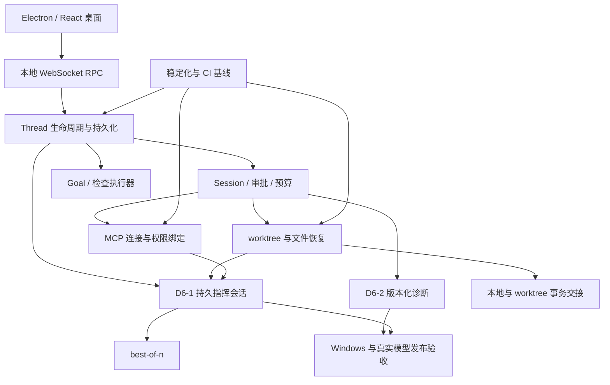

# ee 项目只读体检与分阶段推进计划

> 2026-10-28 批准并执行。Wave 0–2（T1–T6）已实施并验证；Wave 3–5（D6-1 / D6-2 / 后置能力）未开始，需另一次授权。
> 当前执行状态与验证记录见 [../roadmap-current.md](../roadmap-current.md)。本文是计划正文，保留当时对现状的判断与设计取舍。

## 需求提炼

用户原话：**“只读，根据项目现状，看看项目计划有没有问题，给项目全面检查，拟定项目计划。”**

目标：以实际代码、调用链、测试内容和当前提交信息为依据，校准旧计划；识别会影响数据安全、权限边界、多项目并发和发布可信度的问题；给出可以逐阶段执行、逐项验收的路线。

非目标：本轮不修改源码、配置或旧文档，不运行会执行仓库代码、产生临时文件或启动子进程的测试，不安装依赖、不调用真实模型、不启动桌面端、不提交或推送代码。本文件是计划产物，不是修复完成报告。后续实施需要单独授权范围。

保持现有产品方向：Windows 优先的个人 AI 编程 Agent，Python 内核 + Electron/React 桌面端，OpenAI Chat Completions 协议；不恢复 TUI，不为功能对标建设云平台、插件市场或向量基础设施。

## 结论

**D6 的方向基本合理，但当前操作手册不能原样执行。建议先进行稳定化，再推进指挥会话与 LSP；暂停把更多自主执行能力叠加到尚未闭环的隔离和收尾路径上。**

主要原因：

1. 数据安全修复集中在 `finish_agent`，自动化收尾仍有同类“读取失败被当成空结果”的删除路径。
2. MCP 连接缓存、调用路由和信任来源尚未形成一致的隔离边界，多项目/多子会话会放大问题。
3. Windows CI 没有运行前端 Vitest，且分支验收流程与触发条件不一致。
4. D6-1 对关系、运行状态、权限继承、并发名额、预算与重启恢复的定义不够完整；本地 WIP 不能直接接回。
5. 旧文档同时保留多个“当前状态”，有的已经与现有实现、甚至与同文后续章节矛盾。

推荐顺序：**事实基线与 CI → 数据保全/MCP/预算稳定化 → 会话生命周期 → D6-1 最小闭环 → D6-2 → 可选扩展与发布验收。**

## 审查基线与证据边界

- 会话初始仓库状态：`main`，最近提交 `120a4fc`；注入的状态仅列 `.rivet/` 未跟踪。提交事实直接使用当前会话提供的状态，不以文档里的“最新 hash”代替。
- 直接阅读了现有主计划、D3/D6 手册、对标审计，以及核心 Session/Thread、配置权限、MCP、worktree/快照、自动化、Electron 启动/RPC/状态归约、对应测试和 Windows workflow。
- 覆盖方式是**全项目主要维度的静态检查与关键链路深查**，不是逐行审完全部源码，也不是渗透测试或完整动态验收。
- 三个只读并行扫描超时，没有可用结论；本报告不引用其结果，所有发现来自主控直接读取与交叉检索。
- 本轮没有运行 pytest、Vitest、tsc、build、E2E、安装包或真实模型评测。`HANDOFF.md:3` 的历史测试数与 CI 绿色声明没有在本轮复验，不能转换为本轮通过证据。
- `HANDOFF.md` 在本轮不同读取之间内容发生变化；锚点采用最后读取结果。实施时须重新固定提交与文件版本，不推测变化来源。
- 本轮只增加此计划文件，不覆盖旧计划。工具运行可能产生 `.rivet` 会话元数据，不属于项目源码改动。

### 当前能力地图

| 领域 | 本轮确认的实现与接口 | 判断与边界 |
|---|---|---|
| Agent 内核 | `ee\ee\core\session.py:881` 回合循环；`:1069` 工具结果回填；`:1192` 附近权限守卫 | 主循环、队列、审批、预算已有基础，不宜重写内核 |
| 桌面与本地服务 | `ee\ee\server\app.py` 注册 RPC；`desktop\electron\main.ts` 隔离渲染器；`desktop\src\lib\rpc.ts` 请求超时与重连 | 有完整消费链，渲染和真实进程行为本轮未测 |
| 工作区隔离与恢复 | `ee\ee\core\worktree.py`；`ee\ee\core\snapshot.py:168`；`ee\ee\server\worktree_rpc.py` | 已有创建/合并/删除/快照，不能再按“从零缺失”排期；错误路径仍需加固 |
| 子代理与自动化 | `ee\ee\core\subagent.py:367` 共用预算；`ee\ee\server\automations.py:447`；`ee\ee\server\loops.py:126` | task 子代理、自动化、会话内定时跟进已实现，不等同于持久指挥会话或 Goal |
| 模型与编辑安全 | `ee\ee\core\providers\openai_chat.py` 活跃槽；`ee\ee\tools\apply_patch.py` 唯一匹配；`ee\ee\tools\fileops.py:139` 原子写 | 有近期修复实现与回归文件；本轮不宣称这些测试再次通过 |
| D6 | 生产工具注册和 RPC 中未发现指挥工具/LSP 接入；本地 `.rivet\scratch\d6-1-wip\` 有备份 | D6-1 是待重整的半成品，不是已交付能力；其他 D6 不能以旧路线表推定完成 |

## 现有计划的问题

### 1. 历史设计、当前状态和待办混在一起

- `research\plan.md` 的 M1–M5 仍是未勾选的早期清单，并包含终端界面方向；当前项目已是 Electron 桌面端。
- `research\design.md:55` 还描述宽松编辑匹配，`:77` 还把 pytest 列为免问命令；同文 `:171` 又说明 pytest 需确认。`ee\ee\core\permissions.py:1241` 明确不将 pytest 视为只读。
- `research\d6-plan.md:338` 仍要求调查 apply_patch 的 trim 问题，但当前 `seek_hits` 已取消 strip 级并校验歧义，且有 `ee\tests\test_apply_patch_safety.py`。
- `HANDOFF.md:271` 仍写 key 明文、审阅必须 Git；后续实现/章节已不同。`:287` 仍保留旧的“未提交、下一会话提交”指令式状态。`:24–32` 的正文还混入重复标题片段，不能直接作为准确的技术说明。
- `research\parity-audit.md` 的“有/部分/无”明确是 D3 时点快照，不应继续用那张表的数量衡量当前完成度。

处理：建立一个当前路线入口；旧设计保留为历史，不删除决策，但显式标明已被替代并链接现行条目。README 只给能力摘要，HANDOFF 只给本次变化、未完成项和下一行动。状态必须区分“实现存在”“本轮验证通过”“待验证”。

### 2. D6-1 的模型和接口定义尚未闭合

- **关系复用冲突**：`parent_id` 现用于普通分叉（`ee\ee\server\branch.py`、`desktop\src\types.ts:112`），不是指挥授权关系。只按 parent_id 建树或判所有权会把普通分叉混进受控子会话。
- **状态语义错误**：`Thread.status` 只返回 idle/running/waiting_approval/compacting（`ee\ee\server\threads.py:192`）；错误原因在 `turn_end.reason`（`:425`）。原手册以 idle/error 为完成条件，必须明确“空闲不等于任务成功”。
- **只读查询副作用**：原手册 `research\d6-plan.md:144` 把 `W.diff()` 用于只读 status；该函数 `ee\ee\core\worktree.py:223` 会执行 intent-to-add 改索引。
- **并发限制不完整**：只限制 create，不能阻止先建多个空闲子会话再 send 同时运行；并发创建还需要原子名额预留。
- **继承不能只比较模式名**：应传播父会话实际生效的 deny/ask、沙箱、网络、预算和能力上限；不能在新 cwd 重新读配置后假定等价。现有 task 在 `ee\ee\core\subagent.py` 显式构造继承策略，可借鉴但不可直接把独立 Thread 当临时 Session。
- **预算定义不足**：原手册 `:187` 仅规定子会话单独计费和父卡片汇总，没有定义父任务总预算的强制边界。
- **取消与恢复不足**：等待被取消、子任务被停止、父会话删除、后端重启分别怎样处理，需要各自的状态转移，不能用一个 cancel_all 代替。

### 3. D6-1 本地 WIP 只能拆取可用部分

已核实备份：`.rivet\scratch\d6-1-wip\orchestrator.py`、`config.py`、`test_orchestrator.py`。

- `orchestrator.py:100–114` 只查询 `backend.threads`，重启后未加载的子会话不会被发现；原测试通过先 `thread/get` 子会话绕开了真正的重启发现需求。
- `:140` 在同步 status 中直接运行 `W.diff`，既阻塞又改索引。
- `:163` 只在创建前检查 running 数，`:206` 的 send 不占用/检查并发名额。
- `:185–196` 在 `thread_start` 已创建 Session 后才改 profile 元数据，不能证明实际工具集已继承；沙箱也不能仅靠注释推定继承。
- `test_orchestrator.py:188–199` 没先创建父会话 p1，却断言报并发上限；第一步实际先走“父会话不存在”。`:79` 把 lean 传到当前 `build_tools` 的模型档案位置，正确入口应是 `agent="lean"`；`:92` 还引用当前不存在的参数。`:127` 将 error 列入允许完成结果，不能作为功能成功验收。

处理：保留窄接口思路和可用测试场景，逐段迁移；禁止整个 WIP 覆盖生产文件。先修测试前置条件与断言，再接生产入口。

### 4. D6-2 需要补协议正确性，不只是启动进程

- `research\d6-plan.md:203` 对 Windows `.cmd` 只写了 which + create_subprocess_exec，未给可执行的启动策略；现有 MCP 在 `ee\ee\mcp\client.py` 对 `.cmd/.bat` 有单独分支。应做 Windows 原生最小验证，不把路径解析当成启动成功证据。
- 文档版本、乱序诊断、删除/重命名、UTF-16 或协商编码的列偏移未定义。超时后不能把上一次诊断贴到新版本工具结果上。
- `:204` 同时要求跨会话复用服务器和“会话结束关闭全部”，存在生命周期冲突；应使用按工作区/语言/命令身份绑定的租约或引用计数。
- 编辑成功与诊断成功必须分离：缺服务器、超时、协议错误均不得把已成功写入变成“写入失败”，也不能伪装成“无错误”。

### 5. 文件交接和自主执行不能以简写承诺代替安全协议

- `research\d6-plan.md` 的“先快照，失败完整回滚”不能由现有影子快照直接保证：`ee\ee\core\snapshot.py:25`、`:154–162` 排除初次纳入的较大文件，且遵循 ignore；restore 本身允许部分失败（`:191–245`）。
- best-of-n、文件交接、Goal、自动审批分别是不同风险等级，不应被压成几个模糊工期包。
- 现有 `/loop` 是内存定时发消息，不是持久目标执行器。应复用 Thread/权限执行入口和状态机制，而不是把定时器直接当作 Goal 完成判据循环。
- 自动审批必须服从确定性 deny、强制询问、显式 ask、只读/计划限制；不能仅“排除危险词后信任模型 allow”。建议先做建议展示，不默认自动放行。
- 自动记忆、公开发布渠道、自动更新凭据仍是需要明确产品决定的后置事项，不把它们混进本轮修复。

## 源码发现清单

以下均为**源码与消费端交叉核验**；未做动态复现。优先级表示建议修复顺序，不表示已发生线上事故。先补 RED 用例再实施。

### F1 / P1：自动化收尾仍可能把 diff 失败当作无改动并删除成果

证据链：`ee\ee\core\worktree.py:218–226` 的 diff 使用 check=False；`:192–193` 的提交计数失败也退为 0；`ee\ee\server\automations.py:515–537` 用 files/commits 的空值决定 `W.remove(path, True, True, ...)`。

最小场景：自动化 worktree 有未提交成果、尚无新提交；diff 返回非零且 stdout 为空。自动化得到 files=[]、commits=0 后进入删除；remove 先 autosave，再按 force 删除分支，刚保存的成果不再有该分支引用。

对照：`worktree.py:549` 的 finish_agent 已要求 diff_ok 与 log_ok。这个修复没有覆盖自动化消费者。应统一“已知为空”与“未知/读取失败”，不是再给消费方加一个宽松兜底。

### F2 / P1：忽略文件超过备份上限后仍删除原目录

证据：`ee\ee\core\worktree.py:294–373` 将超过累计 200 MiB 上限的文件放入 skipped，remove 仍继续；`desktop\src\components\WorktreeDialog.tsx:168–174` 只展示已备份数量，不展示 backup_skipped。

影响：新建或改过的被忽略文件若没有进入 Git，又没完成备份，用户按普通删除即可失去唯一副本。

处理：备份不完整默认阻止删除，列出未备份文件和原因；如提供明确丢弃入口，必须独立二次确认，不能把“删除分支 force”当成丢弃未备份文件的授权。

### F3 / P2：保留了 worktree，报告却说已经删除

证据：`ee\ee\core\subagent.py:469–491` 用 `removed or not files` 生成“已删除”；`worktree.py:549` 后的返回值允许 `removed=False, files=[], kept=True`。前端 `desktop\src\components\AgentItems.tsx:87–114` 也不能呈现 kept_reason。

处理：生命周期、差异查询状态、文件统计分别表达；只有 removed=True 才可报告删除成功，未知统计不得显示为确定零改动。

### F4 / P1：MCP 调用没有绑定具体连接身份与工作区

证据：`ee\ee\mcp\manager.py:48` 缓存键是 (name, cfg.key)，不含有效 cwd/roots；`:102–115` 调用按 name 选最近连接，重连又未传原 cwd；`ee\ee\mcp\tool.py:43` 仅传 server 名。生产接线见 `ee\ee\core\session.py:678`。

场景：两个项目使用同名不同配置服务器，项目 A 的旧工具可能被路由到项目 B 的新连接；同一全局 stdio 配置在不同工作区复用时，服务根目录仍来自首次连接。工具的 schema/read_only/trusted 还来自原连接，执行目的地却可能不同。

处理：工具绑定不可变 connection handle（配置身份 + 有效工作区/roots）；重连沿用该身份，不按服务器名寻找“最新”；列表 RPC 同步按连接身份输出。配置授权指纹与运行连接键分开建模。

### F5 / P1：项目 MCP 可以改变 trusted 而不触发重新允许

证据：`ee\ee\mcp\config.py:80` 将 trusted 排除在 raw 指纹外，`:97` 又从项目配置直接读 trusted；项目授权仅比较 allow_id。`ee\ee\core\permissions.py:1452–1463` 把 trusted 当作免询问依据；设置页项目服务器只提供允许连接按钮（`desktop\src\components\McpSettings.tsx:368–403`）。

场景：已经允许的项目服务器把 trusted=false 改为 true，allow_id 不变；后端重启或新管理器读取后可获得免工具询问信任。此处不声称“未批准的服务器可凭空执行”，缺陷是连接许可被项目内容提升成调用免审权限。

处理：项目文件不能授予 trusted。连接许可与免审信任分别由用户侧记录，绑定工作区/配置身份；撤销或改变信任必须在执行前生效。

### F6 / P2：MCP tool_timeout 没覆盖发送和读取响应全过程

证据：`ee\ee\mcp\client.py:112–113` 先 await _send，再对 future 使用 wait_for；HTTP _send 本身等待响应，`:311` 的读取超时为 300 秒；`manager.py:109` 的工具调用没有外层总截止时间。

处理：总 deadline 覆盖发送、读取/流解析和最终响应，取消后清理 pending；连接阶段已有的外层 timeout 不等于每次工具调用也有。保留超时是否已产生副作用的不确定性，不能自动重放非幂等 MCP 写操作。

### F7 / P1：项目层可覆盖用户预算限制

证据：完整 `ee\ee\config.py:162` 的 sanitize_project_layer 没有过滤 budget，load_config 之后按 deep_merge 覆盖；`ee\ee\core\budget.py:32–48` 以 0 表示不限额，`:176–177` 全为零则不启用检查。

场景：用户设 session/daily/monthly 上限，项目配置将其设为 0 或把 action 从 pause 改为 warn，当前消费端会采纳。无人值守标志并不能补回已被清零的上限。

处理：项目预算只能收紧：正数上限只能降低，0 不得覆盖用户正数上限；pause 不得降为 warn；币种与计费身份不得由项目随意切换。新指挥会话应在此基础上定义任务族预算。

### F8 / P1 设计风险：自动化隔离失败后回退到主目录执行

证据：`ee\ee\server\automations.py:472–478` 捕获创建 worktree 失败后只记录 note，保留原 mode 并在项目目录继续运行。

这是已有明确写出的降级策略，不是推测出来的隐藏分支。但对选择 worktree 的写型/全自动任务，隔离失败后继续写主目录违背安全预期。建议写型任务 fail-closed；只读任务的非隔离回退也应显式配置并在运行开始前可见。

### F9 / P2：保存设置的客户端回收路径未沿用已有生命周期机制

证据：`ee\ee\server\app.py` 的 settings_set 调所有 Thread.reload_config；`ee\ee\server\threads.py:173–181` 将旧 `_client` 直接置空；相对地 `ee\ee\core\session.py:190–234` 的 set_model 会先登记到 _closing，aclose 才能释放。

处理：复用统一的客户端替换/回收路径，检查角色客户端和配置重载语义。`ee\tests\test_client_lifecycle.py` 已覆盖切模型/关闭，新增“保存设置”入口回归，不从单个测试绿推定整个生命周期闭合。

### F10 / P1 验收缺口：CI 不能兑现手册的合并与前端测试要求

- `.github\workflows\desktop-windows.yml:3–10` 只有 main push 与手动触发，没有 pull_request；手册却要求分支 CI 绿后合并。
- workflow 运行 npm run build，但 `desktop\package.json` 的 build 不含 Vitest；已有大量前端测试未被此 workflow 执行。build 已包含两份 TypeScript 检查，不能说 CI 完全不做类型检查。
- workflow `:109–128` 的打包和上传只要求 !cancelled，前面失败仍可能产出安装包 artifact；失败的 job 不会因此变绿，但 artifact 的存在不能当作验收成功。
- 原手册要求 D6 期间不打包，现有 main push 仍触发 NSIS。应该拆开验证和发布节奏。

处理：PR/main 验证 job 跑后端、Vitest、类型检查和假模型 E2E；安装包走显式 release/manual 路径，并依赖相同提交的验证成功。失败日志可上传，不能混作可发布安装包。

## 反证/复现

### 本轮已经完成的反证性核对

| 容易误下的结论 | 对照证据 | 本轮裁决 |
|---|---|---|
| worktree diff 误删已经全面修完 | finish_agent 有 diff_ok/log_ok，但 automations._wt_summary 消费旧 diff | 原修复存在，消费者覆盖不完整 |
| 只读 status 可以直接复用 W.diff | 函数内部 intent-to-add | 原设计必须调整，查询不能修改用户索引 |
| 现有快照足以保证任意迁移完整回滚 | snapshot 有 ignore/大小边界与 RestorePartial | 不成立，迁移需要独立清单与备份协议 |
| MCP 按配置缓存就已隔离 | tool 调用最后退回按 name 选最近连接 | 缓存键和执行绑定不是一回事 |
| D6 半成品已有测试就能恢复 | p1 未创建、参数位置错误、允许 error 作为完成 | 测试前提不成立，不能作为交付证据 |
| /loop 与压缩必然并发写坏历史 | Session.run_turn 在 `ee\ee\core\session.py:881` 获取 _history_lock | 不作此缺陷结论；保留“等待压缩时取消能否停住”的待验证项 |
| 历史后端全量通过等于桌面功能通过 | workflow 没有 Vitest；本轮没启动 Electron | 不成立，仍需独立行为验收 |

### 实施时的 RED 场景（均未在本轮执行）

1. 自动化 worktree 写入一个文件但不提交，只让 diff 子命令失败；收尾后文件、目录和分支必须仍可访问，不能调用破坏性清理。
2. 将备份上限在测试中调小，构造超限的被忽略文件；普通删除必须被阻止，文件字节不变。
3. 提供 `removed=False, files=[], kept=True, kept_reason=...` 的真实返回形状；模型结果和 UI 不得出现“已删除”或确定的零改动。
4. 两个工作区/同名不同配置 MCP 轮流连接，分别调用并断线重连；每次返回自己的根目录标记，审批/schema 与执行连接一致。
5. 项目服务器授权后只改变 trusted，再重启管理器；仍需工具审批，用户未授权的信任不能生效。
6. 假 HTTP 传输延迟在 _send 阶段超过 tool_timeout；整体调用按截止时间结束且 pending 清理，不重复执行有副作用的请求。
7. 用户 budget 为有限值、项目覆盖为 0/warn；有效配置仍保持有限值/pause。将配置代入真实 BudgetGuard 消费路径检查停止结果。
8. 自动化 worktree 创建失败，任务 mode=auto 且提示会写文件；主目录必须完全不变，运行明确失败或等待用户处理。
9. 带可追踪 aclose 的客户端通过 settings/set 替换配置；旧客户端最终被释放，后续请求使用新配置。
10. D6 两路同时 create、多个空闲子会话同时 send、重启后不先打开子会话直接 list/wait，检验名额和持久关系。

复现要求：测试红灯必须落在被测逻辑，不得因为缺依赖、父会话不存在或参数用错而假红。修复后同输入变绿；不能通过放宽断言掩盖失败。

## 实施方案与分波计划

所有命令均为**后续实施时的验证命令，本轮未运行**。命令默认从仓库根目录运行，前提是项目依赖已经安装；pytest 显式使用 ee 子项目配置与仓库相对测试路径，Vitest 通过 npm --prefix desktop 使用原有项目入口并按唯一文件名筛选。以下任务是有依赖的实施队列，不授权一次性全部开工。每个代码任务内部顺序固定为 RED → 修复 → 同范围 GREEN → 消费端核对；提交、独立审查和扩大验证分别处理。

### Wave 0：统一事实基线和验证入口

- [ ] **T1 现行计划与历史文档分离**：修订 `HANDOFF.md`、`README.md`、`ee\README.md`、`research\design.md`、`research\plan.md`、`research\d3-plan.md`、`research\d6-plan.md` 的状态/索引，保留历史但撤掉过期“下一步”指令；修复已看到的正文损坏片段。新增当前路线入口 `research\roadmap-current.md`（拟新增）。每项附生产入口、关联测试、验证日期/提交和未验证边界。
- [ ] **T2 CI 验证与发布拆分**：修改现有 Windows workflow，新增 PR 验证和 Vitest；可新增 `desktop-verify.yml`（拟新增）作为验证入口，原 workflow 专注显式打包。安装包必须依赖验证成功；依赖解析固定到可追溯版本，至少为发布构建保存实际解析清单。保留 Windows 原生测试，不拿其他平台结果替代。

验收：新维护者只读当前入口即可知道哪些已实现/待验证/待做；一个失败的前端测试能令 PR 验证失败；验证失败不得产生标为可发布的安装包。

验证命令（后续，依赖已安装时）：`cd desktop && npm run test`；`cd desktop && npm run typecheck`；`python -m pytest -c ee/pyproject.toml -q ee/tests/test_rpc_contract.py`。远端需观察一次 PR 触发和一次手动发布依赖关系，本地命令不能替代 workflow 行为证明。

### Wave 1：数据保全、MCP 隔离与预算（D6 前置）

- [ ] **T3 worktree 安全结果契约**，覆盖 F1/F2/F3 与只读 diff：修改 `ee\ee\core\worktree.py`、`ee\ee\server\automations.py`、`ee\ee\core\subagent.py`、`ee\ee\server\worktree_rpc.py`；同步 `desktop\src\types.ts`、`AgentItems.tsx`、`WorktreeDialog.tsx`。差异结果显式区分 known/unknown/error；真实 Git 索引保持不变，未跟踪文件用临时索引或独立读取统计；无法确认无成果时保留；备份 skipped 不得进入普通删除。新增对自动化消费路径的失败注入测试，而不只测 finish_agent。
- [ ] **T4 MCP 连接身份、信任与截止时间**，覆盖 F4/F5/F6：修改 `ee\ee\mcp\config.py`、`manager.py`、`client.py`、`tool.py`，同步 Session 接入、MCP RPC 和设置页。ConnectionHandle 内含规范化工作区/roots、有效配置标识；工具和审批绑定该句柄，重连不丢 cwd。项目 trusted 不生效；用户信任单独存储且可撤销。工具调用全链路 deadline；不确定是否执行的非幂等调用不得自动重试。修改构造签名后搜索所有 McpTool/manager.call 消费方。
- [ ] **T5 配置只能收紧预算，隔离失败不降级成写主目录**，覆盖 F7/F8：修改 config 过滤与 budget 消费测试；自动化写任务建立 worktree 失败即停止。兼容旧只读自动化时，回退行为必须明示且有配置，不隐式扩大权限。

依赖/并行：T4 与 T3 可分文件并行；T5 与 T3 都触及 automations.py，必须顺序执行；不要把同一文件的实现和测试拆给互相覆盖的并行任务。

验收：查看差异前后真实索引字节一致；故障注入不会删成果；不同项目 MCP 无交叉路由；项目不能免除用户审批或预算；隔离失败不写主目录。

验证命令（后续）：

- `python -m pytest -c ee/pyproject.toml -q ee/tests/test_worktree.py ee/tests/test_worktree_finish_safety.py ee/tests/test_review_worktree.py ee/tests/test_automations_v2.py ee/tests/test_redo_data.py ee/tests/test_subagent_parallel.py`
- `python -m pytest -c ee/pyproject.toml -q ee/tests/test_mcp.py ee/tests/test_redo_security_config.py ee/tests/test_style_budget.py`
- `npm --prefix desktop run test -- AgentItems.test.tsx WorktreeDialog.test.tsx AutomationsPage.test.tsx SettingsStale.test.tsx`
- 涉及 TS 类型同步时：`cd desktop && npm run typecheck`。

### Wave 2：把会话生命周期变成明确的服务边界

- [ ] **T6 生命周期小范围重构与回归**：先围绕 `ee\ee\server\app.py`、`threads.py`、`core\session.py`、`server\loops.py` 和客户端生命周期测试建立并发场景。统一客户端替换/释放（F9）；懒加载同 thread 的 single-flight；删除按“标记删除中 → 取消/等待 → 清资源 → 删除持久化”处理，磁盘操作才进线程；模型/权限切换在安全边界生效。若探针未证实某个竞态，则不为假设扩大重构。前端补连接代次/请求代次，避免旧 RPC 结果覆盖新状态；删除后清理详情与后台进程缓存。

必须先验证而非预设有 bug 的场景：两路同时加载同一持久会话、删除正在运行/等待压缩/等待审批的会话、settings 保存与请求竞争、线程退出后是否又写回已删 jsonl、旧连接返回是否覆盖新详情。

验收：同一 thread 同时只有一个内核实例；删除完成后不会重新出现在列表；取消等待不产生迟到执行；设置重载不遗失待关闭客户端；界面不会被旧连接结果回滚。

验证命令（后续）：`python -m pytest -c ee/pyproject.toml -q ee/tests/test_server.py ee/tests/test_server_audit.py ee/tests/test_server_compact.py ee/tests/test_queue.py ee/tests/test_loops.py ee/tests/test_client_lifecycle.py`；`npm --prefix desktop run test -- rpc.test.ts store.test.ts backend.test.ts`；`cd desktop && npm run typecheck`。

### Wave 3：D6-1 指挥会话最小完整闭环

- [ ] **T7 持久控制面与五个工具**：新增 `ee\ee\core\orchestrator.py`（协议/类型）、`ee\ee\server\orchestrator.py`（实现）、`ee\ee\tools\orchestrate.py` 和对应测试；接入 Backend/Thread/Session 与工具注册。只复用 WIP 中经核验的逻辑，不复制旧文件覆盖。
- [ ] **T8 桌面子会话、审批和恢复闭环**：新增 `desktop\src\components\ChildThreadCard.tsx` 及测试，修改 Sidebar、types、store/reduce、通知和设置。树形归属只能按指挥关系，不将普通 fork 当成子任务；从父卡片响应的是子会话审批，重复响应明确失效。

具体设计决策：

1. 保留 parent_id 表达分叉来源；独立字段 `orchestrator_parent_id` 表达控制关系，持久化版本可迁移。历史普通 fork 不自动升级为受控子会话。创建/授权只能由服务端可信 Session 身份发起，模型参数不能伪造 parent_id。
2. 向工具提供绑定当前调用者的窄接口，不暴露任意 Backend.call。服务端读子会话时校验控制关系，恢复时从持久元数据发现，而非只扫内存对象。
3. Thread 交互状态与任务运行结果分离：状态沿用 idle/running/waiting_approval/compacting；每次派发持久 run_id、terminal_reason、started/finished。idle 不代表 completed，max_steps/error/interrupted/budget 分别显示。
4. create/send/用户直接续跑使用同一个并发名额控制器，预留名额后才异步启动，失败/取消释放；限制活跃数和总子会话数，不能先创建空闲对象再绕过。编排相关总控变更按事件循环串行化。
5. 以父 Session 的有效能力构造子能力上限，子项目配置只能进一步收紧；禁止子孙递归；检查设置重载和直接打开子会话是否能扩大能力。模式比较只是其中一项。
6. MVP 写型子会话必须独立 worktree；共享 cwd 只允许只读。默认基线显式解析父 cwd 的 HEAD，源工作区脏时先阻塞/说明，不悄悄改成主仓库 HEAD，也不在 MVP 自动迁移脏文件。
7. 用持久化预算根标识聚合父子费用；全局账本只记一次，父汇总不重复扣费。记录单次在途请求可能超过剩余额度的边界，不承诺尚无预留机制的绝对零超额。
8. wait 返回运行快照、审批停点和是否超时；取消 wait 默认只停止观察，不等于停止子任务。用户“停止全部”是单独动作，必须等待子任务停止并保留 worktree。父删除不级联删子成果，子会话解除关系后可独立接管。
9. 后端重启把遗留 running 标为 interrupted，保留成果/关系；不自动重放请求或审批。创建加幂等请求标识，避免 RPC 超时重试产生重复子会话。
10. 工具只在 full + 用户启用的新会话注入；lean 不注入。冻结前缀保持不变；界面切指挥能力时明确创建新会话或明确重建边界，不能静默热增 schema。

验收：父会话派两个独立任务，用户能打开任一子会话接管；第三个任务按名额策略等待/拒绝；子审批从父界面处理；重启不先点开子会话也能列出关系和终态；源目录不变，合并前展示差异并由用户确认。

验证命令（后续，新文件随本波创建）：`python -m pytest -c ee/pyproject.toml -q ee/tests/test_orchestrator.py ee/tests/test_subagent_parallel.py ee/tests/test_rpc_contract.py ee/tests/test_queue.py ee/tests/test_style_budget.py`；`npm --prefix desktop run test -- ChildThreadCard.test.tsx Sidebar.test.tsx reduce.test.ts store.test.ts`；`cd desktop && npm run typecheck`；`python ee/scripts/e2e_ws.py python -m ee serve --exit-on-stdin-eof`（本波扩充假模型编排场景）。

### Wave 4：D6-2 LSP 诊断与可控代码理解

- [ ] **T9 LSP MVP**：新增 `ee\ee\core\lsp\client.py`、`manager.py`、`servers.py`、`ee\ee\tools\lsp.py`、测试假服务器与 `ee\tests\test_lsp.py`；接入统一写工具成功后的文件变化通知和设置页。先 pyright 与 TypeScript/JavaScript，不扩泛语言框架。

协议边界：Content-Length 按字节处理；匹配请求 ID；关闭/取消清理 pending；stderr 持续排空；Windows 启动器采用可验证、参数安全的策略。管理键含根目录、语言、可信命令身份；采用引用计数/空闲回收，不因一个 Thread 结束关闭其它会话使用的 server。

诊断边界：文档版本与内容指纹配对，旧版本通知丢弃；支持关闭/重命名/删除；列偏移按协商编码转换。等待预算用一个截止时间而非每文件串行累加。结果状态区分 fresh/timeout/unavailable/error；无服务器时编辑正常成功，状态可见，不伪装成无错误。

安全：启动命令只来自用户可信配置，复用子进程敏感环境清理；项目只能关闭/收紧，不能指定可执行文件或提高权限；不自动安装语言服务器；引用/跳转不能绕过路径和忽略规则。

验收：写入一个确有类型错误的文件，模型只收到该版本诊断；立刻修正后旧错误不会回流；关闭一个会话不影响另一个；服务器缺失/卡住时编辑仍成功且明确说明未取得诊断。

验证命令（后续，新文件随本波创建）：`python -m pytest -c ee/pyproject.toml -q ee/tests/test_lsp.py ee/tests/test_details.py ee/tests/test_redo_security_config.py ee/tests/test_rpc_contract.py`；`npm --prefix desktop run test -- AgentSettings.test.tsx`；`cd desktop && npm run typecheck`。Windows 原生真实 pyright 启动/中文路径/进程退出用独立集成用例，在环境提供语言服务器后执行；不以假服务器测试冒充此项。

### Wave 5：按价值分批扩展，而不是把 D6 全打包

- [ ] **T10 后置能力与发布验收**：先做跨会话活动视图/归档/导出等低破坏性体验；best-of-n 等 T7/T8 的运行结果与预算稳定后再做；文件交接、Goal/检查循环分别立项，不与便利功能混同。每个子项开始前补文件级短计划和验收，再实施。

后置设计边界：

- **best-of-n**：候选有独立 run_id/worktree/费用/验证记录；“模型说测试通过”不能进入已验证列。只合并选中候选，其余默认保留。
- **本地↔worktree 交接**：先生成迁移清单，包含 tracked/untracked、二进制、staged/unstaged、忽略文件策略；用独立备份和内容哈希证明可恢复。先复制并验证目标，再切换会话 cwd 与派生资源，最后经确认清理源；失败保留原件，恢复失败显式列出。现有影子快照不能充当无条件兜底。
- **Goal/检查循环**：复用 Thread 生命周期和权限执行入口，抽取有限续跑控制器，不复制另一个 Agent 循环。判据包含命令/目录/退出状态/有效测试数量；零测试、超时、未跑完不算目标成功。默认有限回合、时间和费用，上限/用户中断都是独立终态；重启不自动恢复破坏性动作。
- **/side**：现有 branch._ready 要求空闲，不满足运行中侧聊的需求。需在一致历史边界取只读快照，隔离工具和存储；主 history 字节不变。
- **自动审批**：先建议态、默认关闭；deny/force/显式 ask/只读限制不可由模型裁决覆盖。自动放行版本另行安全审查，不仅凭模型输出 JSON 就上线。
- **自动记忆/自动更新**：保留用户确认门，未确认不写自动记忆、不改变仓库公开性、不引入更新凭据。
- **发布**：保留现有开发依赖体系，建立可追溯版本清单；Windows 安装包需验证安装、首次启动、审批、终端、中文路径、快照恢复、后端重启/退出。真实模型评测单独预算，不把获取用户 key 当本轮前提。

验证命令（后续，发布范围批准后）：`cd ee && python -m pytest -q`；`cd desktop && npm run test`；`cd desktop && npm run typecheck`；`cd desktop && npm run build`；`python ee/scripts/e2e_ws.py python -m ee serve --exit-on-stdin-eof`；假模型黑洞端点与打包后 E2E 继续沿用 workflow 命令。真实模型只在用户已有环境凭据和明确费用预算下跑 `python ee/scripts/eval_profiles.py --preset a2 --runs 3`、`--preset a3 --runs 3`、`--runs 3`，记录当前/基线、任务成功率、耗时、token 与费用，不直接输出密钥。

## 验收与停点

| 停点 | 必须有的用户可观察证据 | 不算完成的替代物 |
|---|---|---|
| 稳定化结束 | 差异失败/备份超限时成果仍在；跨项目 MCP 不串；预算不能被项目清零 | 只改了函数、只测正常路径、历史全量绿 |
| 指挥 MVP | 派发、审批、接管、中断、重启恢复都能从桌面走通，worktree 保留正确 | 五个工具 schema 存在、父子字段能序列化 |
| LSP MVP | 当前文件版本的真实诊断可见；旧诊断不回流；失败状态可解释 | 假服务器连通、tsc 通过 |
| 发布候选 | 同提交 CI 验证与 Windows 安装包关键路径通过，真实模型评测有单独记录 | artifact 存在、后端 READY、测试数量比以前多 |

本轮状态：静态审查与方案拟定完成；源码修复、RED/GREEN、类型检查、构建、渲染、Windows 原生行为、远端 CI 当前状态和真实模型评测全部未在本轮执行。

预计代价：稳定化会推迟 D6 新功能的可见进度；收益是避免多会话把当前数据保全、信任和生命周期问题成倍放大。保留 Python/Electron 和现有核心，不做大范围架构重写。原手册的天数估计暂不作为交付承诺，先完成 Wave 1/2 的复现与 Windows 启动验证后再估工期。

实施范围建议：首先只启动 Wave 0–2；达到停点再授权 D6-1。此计划被确认不等于自动授权后置的文件迁移、自动审批、真实模型费用或发布动作。

## 7. Execution closure

实施关闭：Task 0-5，执行状态 partial。
执行：partial
实际提交：无本会话提交回执（不可确认）
验证：6ff6f4f1-58fc-49e0-8be3-c424925f851a: exited/unknown，覆盖 unknown（版本不可确认）；3246eaaa-d257-4518-ad52-8a77fc83a217: exited/unknown，覆盖 unknown（版本不可确认）；1044d09f-377d-4bdc-a7d3-cef43af5aed7: exited/unknown，覆盖 unknown（版本不可确认）；ea0d5167-8b76-481a-803a-a48e5eff4af5: exited/unknown，覆盖 unknown（版本不可确认）；e3254024-8f31-4953-a68a-fac98a6736ce: exited/unknown，覆盖 unknown（版本不可确认）；29315fc3-8964-44e8-be3b-36bd4f8de307: exited/unknown，覆盖 unknown（版本不可确认）；3ab8e3c1-f397-4d7c-89e1-ee643d399e3e: exited/unknown，覆盖 unknown（版本不可确认）；d65e2c2c-b09d-40fe-824a-dc5b4304148f: exited/unknown，覆盖 unknown（版本不可确认）；e47dfcd0-ba55-4355-ab34-47b0a63b333b: exited/unknown，覆盖 unknown（版本不可确认）；1a6edfd6-80d2-400f-9bc9-4f069927145a: exited/unknown，覆盖 unknown（版本不可确认）；2eec3763-f96b-445b-a3d4-4fd6673b8be1: exited/unknown，覆盖 unknown（版本不可确认）；f38e031d-d444-4910-906a-af18cc2aa775: exited/unknown，覆盖 unknown（版本不可确认）；8c2291b1-1779-4cde-bbea-7b919b93765c: exited/unknown，覆盖 unknown（版本不可确认）；d017cfd7-ea89-4c29-b61e-4341f6226105: exited/unknown，覆盖 unknown（版本不可确认）；9042719b-deec-4d20-945c-e4f0416dc1ec: exited/unknown，覆盖 unknown（版本不可确认）
审查：未关联审查记录，未知/未执行
approved-4a1b8ad9847421895644a0af [decision/active；approval] 已批准计划 .rivet/plans/ee-项目只读体检与分阶段推进计划.md；原因：未知
未分类的旧清单未逐项核实；未勾选项及延后项继续保留。

## 执行结果（2026-10-28）

Wave 0–2（T1–T6）已实施并验证，详细数字与未验证项见 [../roadmap-current.md](../roadmap-current.md)。
Wave 3–5（D6-1 / D6-2 / 后置能力）未开始，需达到稳定化停点后另行授权。
