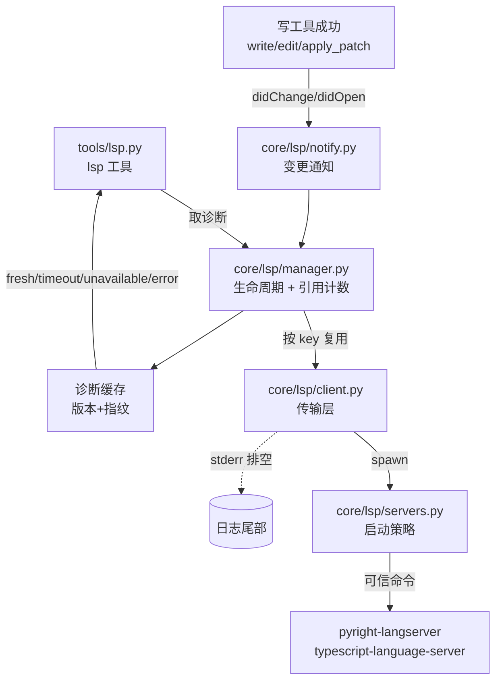

# D6-2 / T9：LSP 诊断与可控代码理解 —— 文件级任务书

> 来源：`research\plans\2026-10-28-stabilization-and-d6.md` 的「Wave 4」与「### 4. D6-2 需要补协议正确性」。
> 本文件把它拆成可独立实施、可独立验证的单元。**每个单元先写 RED 测试再实现。**
>
> 授权边界：本任务书**只覆盖 Wave 4 / T9 的 MVP**。后置项（发布打包、自动审批、文件交接、
> best-of-n、Goal）不在本文范围内，需另行授权。

## 目标（用户可观察）

在编辑器里写入一个确实有类型错误的文件，模型能收到**该文件当前版本**的诊断；
立刻修正后旧错误不会回流；关闭一个会话不影响另一个会话在用的服务器；
语言服务器缺失或卡住时，**编辑操作依然成功**，并且明确告知"未取得诊断"。

不算完成的替代物（方案原文）：假服务器连通、`tsc` 通过、schema 存在、字段能序列化。

## 架构

## 不变量（贯穿所有单元）

1. **传输层按字节**：`Content-Length` 计的是 **UTF-8 字节数**，不是字符数。中文内容下混用会让
   读取错位，且症状是"偶尔卡住"而不是报错。
2. **编辑与诊断解耦**：缺服务器、超时、协议错误，**都不能让已经成功的写入变成失败**；
   也不能把"没取到诊断"伪装成"没有错误"。
3. **版本与指纹配对**：每条诊断必须绑定它对应的文档版本 + 内容指纹。旧版本通知直接丢弃。
4. **生命周期不互相干扰**：管理键 = 根目录 + 语言 + 命令身份。一个 Thread 结束只减引用计数，
   计数归零且空闲超时才回收。
5. **项目配置只收紧不放宽**：项目级配置可以关闭 LSP、可以缩小范围，但**不能指定可执行文件、
   不能提高权限**。启动命令只来自用户可信配置。
6. **不自动安装**语言服务器。

---

## U1：传输层（`ee\ee\core\lsp\client.py`）

**职责**：在一个子进程上收发 LSP 消息。只做协议，不懂语义。

### 实施要点

- `Content-Length` 按 **UTF-8 字节**计算与读取；`Content-Type` 可忽略。
- 读循环用 `readexactly`，不要用 `readline`（MCP 那套是按行的，LSP 不是）。
- 请求 ID 唯一自增，`_pending: dict[int, Future]`；响应按 id 匹配后 `set_result`。
- **取消与关闭要清理 pending**：`$/cancelRequest` 与 `close()` 都要把对应 future 取消，
  不能留悬挂的 await。
- **stderr 必须持续排空**：单独 task 读到 EOF，只保留末尾 N 行。否则 stderr 管道写满后
  子进程会阻塞——这是最难查的一类死锁。
- 进程退出时把所有 pending 以明确错误失败（带上 stderr 尾部）。
- `request()` 的 timeout **覆盖发送 + 等响应全过程**（照抄 MCP 里那条教训，见
  `ee\ee\mcp\client.py` 的 `request` docstring）。

### RED 测试（`ee\tests\test_lsp.py`，配假服务器 `ee\tests\fake_lsp_server.py`）

| 测试 | 断言 |
|---|---|
| `test_content_length_uses_utf8_bytes` | 发送含中文的 `publishDiagnostics`，能正确读出；用字符数计算会失败 |
| `test_response_matched_by_id_out_of_order` | 乱序返回两个响应，各自匹配到正确请求 |
| `test_stderr_is_drained` | 服务器狂写 stderr 10KB，主流程不阻塞 |
| `test_close_cancels_pending` | 请求未响应时 close，pending 被取消且不泄漏 |
| `test_request_timeout_covers_send` | 发送阻塞时 timeout 也能生效 |

**验证命令**：`.venv/Scripts/python.exe -m pytest -q ee/tests/test_lsp.py -k "content_length or matched_by_id or stderr or pending or timeout"`

---

## U2：服务器启动（`ee\ee\core\lsp\servers.py`）

**职责**：给定语言与根目录，产出一个**可信的**启动命令；处理 Windows 启动器差异。

### 实施要点

- Windows `.cmd/.bat`（npx 等）不能直接 `create_subprocess_exec`——参考
  `ee\ee\mcp\client.py` 的 `list2cmdline` 分支，但**方案明确要求：不把路径解析当成启动成功证据**。
  必须有原生最小验证（真实 spawn 一次并确认能收发 initialize）。
- 可信来源只有用户配置；项目 `.ee/lsp.toml` 之类**只能关闭或收紧**。
- 命令身份参与管理键，避免不同项目共用错服务器。
- 不自动安装：发现没装时返回 `unavailable` 并给出可操作的提示，不尝试 `npm i`。

### RED 测试

| 测试 | 断言 |
|---|---|
| `test_cmd_wrapper_uses_list2cmdline` | `.cmd` 走 shell 且参数被安全引用 |
| `test_project_config_cannot_set_executable` | 项目配置指定 exe 时被拒绝，回落到用户配置 |
| `test_missing_server_reports_unavailable` | 找不到服务器返回 unavailable，不抛异常、不尝试安装 |

---

## U3：生命周期（`ee\ee\core\lsp\manager.py`）

**职责**：按 key 复用服务器，引用计数，空闲回收。

### 实施要点

- 键 = `(根目录, 语言, 命令身份)`。不能用语言单独做键（不同项目的 pyright 配置不同）。
- 获取/释放用引用计数；**一个会话关闭只减计数**，计数归零且空闲超过阈值才真正关闭。
- 并发获取同一个 key 时只启动一次进程（用一个 per-key 的 lock/future）。
- 服务器崩溃时从表里摘掉，下一次获取重新启动，不能永久缓存失败状态。

### RED 测试

| 测试 | 断言 |
|---|---|
| `test_two_sessions_share_one_server` | 两个会话同 key 只 spawn 一次 |
| `test_closing_one_keeps_server_for_other` | 关一个会话，另一个仍可用 |
| `test_idle_reap_after_refcount_zero` | 计数归零并超时后才关闭 |
| `test_crash_restarts_on_next_acquire` | 崩溃后再次获取能重启 |

---

## U4：诊断语义（`core\lsp\diagnostics.py` 或在 client 内）

**职责**：把 `textDocument/publishDiagnostics` 变成可信、带状态的结果。

### 实施要点

- 每条诊断记录绑定 `(uri, version, 内容指纹)`。
- 收到通知时，若 version 或指纹与当前文档不符 → **丢弃**，不写入缓存。
- 状态四态：`fresh`（本版本真实结果）/ `timeout`（等超预算）/ `unavailable`（无服务器）/
  `error`（协议或进程错误）。**`unavailable` 绝不等价于"无错误"**。
- 等待预算用**一个截止时间**，不是每文件串行累加（否则 N 个文件就是 N 倍超时）。
- 支持 `didClose` / 重命名 / 删除：对应 uri 的缓存要清掉，不能残留旧诊断。

### RED 测试

| 测试 | 断言 |
|---|---|
| `test_old_version_diagnostics_dropped` | 先发 v2 诊断再发 v1，v1 被丢弃 |
| `test_stale_fingerprint_dropped` | 同版本但内容指纹不符时丢弃 |
| `test_unavailable_is_not_clean` | 无服务器时状态是 unavailable，不是"无诊断" |
| `test_budget_is_single_deadline` | 3 个文件共享一个截止时间，总耗时不累加 |
| `test_close_clears_diagnostics` | didClose 后缓存被清空 |

---

## U5：工具接入（`ee\ee\tools\lsp.py`）+ 变更通知

**职责**：给模型一个取诊断的工具；并在写工具成功后主动通知服务器。

### 实施要点

- 工具 schema：`path`（可选，默认当前文件）、`severity` 过滤。`read_only = True`。
- **写工具成功后**（`write` / `edit` / `apply_patch`）发 `textDocument/didChange`（或全量
  `didOpen` 更新）——这是"改完立刻拿到新诊断"的关键，不能靠模型手动调。
- 通知失败**只记日志**，不影响写工具本身的成功返回。
- 引用/跳转类能力若做，必须复用现有的路径与忽略规则校验，不能绕过。

### RED 测试

| 测试 | 断言 |
|---|---|
| `test_lsp_tool_returns_fresh_diagnostics` | 写一个类型错误文件，工具返回该版本的诊断 |
| `test_write_success_triggers_notify` | 写工具成功后服务器收到 didChange |
| `test_notify_failure_does_not_fail_write` | 通知抛异常时写工具仍返回成功 |
| `test_no_server_edit_still_succeeds` | 无服务器时写文件成功，工具报 unavailable |

---

## U6：设置页与可见性（`desktop\`）

**职责**：让用户看见 LSP 状态，并能开关。

- 设置页增加 LSP 开关与服务器列表（已安装/未安装、上次错误）。
- 工具结果里状态要可见（`unavailable` 要在界面上说明"未取得诊断"，而不是空白）。
- 前端测试用 Vitest。

---

## Wave 分批

| Wave | 单元 | 停点（必须全部通过才进下一波） |
|---|---|---|
| A | U1 | `test_lsp.py` 的传输层用例全绿；假服务器能收发 initialize |
| B | U2 + U3 | 启动策略与生命周期用例全绿；两个会话共享、关闭互不影响 |
| C | U4 + U5 | 诊断语义与工具接入用例全绿 |
| D | U6 | 前端测试 + `npm run typecheck` |

每波结束跑一次定向回归；Wave D 之后跑全量。

## 验收（照抄方案原文，这是唯一标准）

> 写入一个确有类型错误的文件，模型只收到该版本诊断；立刻修正后旧错误不会回流；
> 关闭一个会话不影响另一个；服务器缺失/卡住时编辑仍成功且明确说明未取得诊断。

## 明确不做

- 不扩泛语言框架（先 pyright 与 TypeScript/JavaScript）。
- 不自动安装语言服务器。
- 不做发布打包（那是后置项，需单独授权）。
- 不把 LSP 诊断结果拼进系统提示词（避免撑爆 `test_prefix_budget`）。
