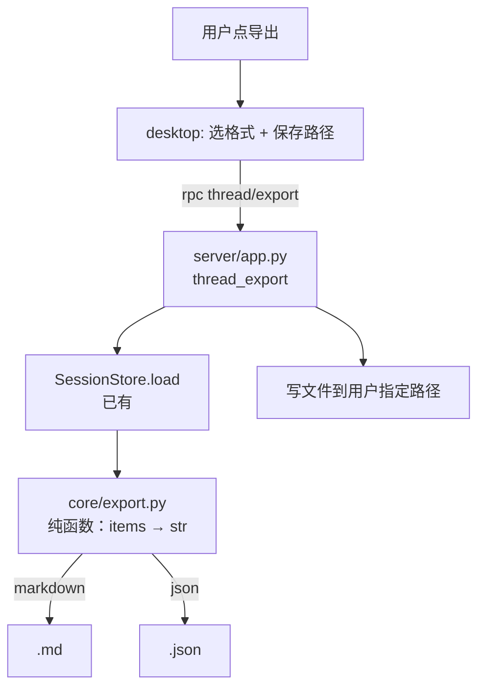

# T10-a：会话导出 —— 文件级任务书

> 来源：`research\plans\2026-10-28-stabilization-and-d6.md` 的「Wave 5 / T10」，
> 其中「先做跨会话活动视图/归档/导出等低破坏性体验」一项。
> 本文件只覆盖**导出**。归档与活动视图经取证判定与既有能力重叠，不在本文范围（见「明确不做」）。

## 需求提炼

用户原话（本轮授权）：「先往后面推进 结果我盯着」——按推荐方向推进 T10。

目标：把一个会话的完整内容导出成可留存、可分享的文件（Markdown 与 JSON 两种），
在桌面端由用户主动触发并选择保存位置。

非目标：不做批量导出、不做导入、不改会话存储结构、不做云同步。

## 取证：为什么只做导出

| 能力 | 现状 | 锚点 |
|---|---|---|
| 会话列表 + 按工作区过滤 + 标题搜索 | 已有 | `ee\ee\server\app.py:233` `thread_list(cwd, query, limit)` |
| 会话全文搜索 + 命中片段 | 已有（D4-4） | `ee\ee\server\app.py:262` `thread_search` |
| 单会话完整内容 | 已有 | `ee\ee\server\app.py:336` `thread_get` → `detail()` |
| 导出 | **无**。`archive\|导出\|export_session` 全仓 grep 为空 | — |

于是「活动视图」「归档」都是在已有 `query` / `thread_search` 之上再搭一套组织方式，
新增状态位与并发迁移问题；收益不明确，代价确定。**导出是唯一真实的缺口。**

## 数据形态（实测，非推断）

`SessionStore.load()` 返回 `{messages, items, meta}`。实测一个真实会话的 items：

```
types = {'user': 2, 'tool': 3, 'assistant': 3, 'turn_end': 2}
user:      {type, text, id, ts, seq, hist, snap, snap_epoch, tree, tree_after}
assistant: {type, text, reasoning, streaming, id, ts, seq}
tool:      {id, type, call_id, name, args, summary, status, output, details, ts, seq}
turn_end:  {type, reason, duration_ms, usage, id, ts, seq}
```

**关键事实**：`tool.args` 与 `tool.details` 是 **Python repr 字符串**（形如
`"{'path': 'C:\\\\Users\\\\...}"`），不是 JSON。导出不能直接 `json.dumps`，
否则得到一堆转义反斜杠。两种导出格式要分别处理：

- Markdown：人读。args 用 repr 原样（它已经可读），output 放代码块。
- JSON：机读。args/details 尝试 `ast.literal_eval` 还原成对象；失败则保留原字符串并标注。

## 目标（用户可观察）

在桌面端打开一个会话，导出为 Markdown，得到的文件包含**该会话的全部回合**：
每条用户消息、每条助手回复（含推理，若存在）、每次工具调用的名称/参数/输出/状态。
导出 JSON 时，工具参数与详情是**结构化的**（不是 repr 字符串）。

不算完成的替代物：RPC 返回 200、文件能写出来是空的、只导出最后一条消息、
工具输出全部丢失。

## 架构



分层理由：`core/export.py` 只做**纯转换**（输入 items+meta，输出字符串），
不读磁盘、不碰 RPC、不关心路径。这样它能单测，也能被 CLI 复用。
`server` 层负责取数据与落盘边界（路径校验、覆盖确认）。

## 不变量

1. **纯函数**：`core/export.py` 的函数不得有 I/O 副作用。同样输入必须得到字节相同的输出。
2. **不丢内容**：每一类 item 都要有输出路径；未知类型不能静默丢弃，要以显式占位呈现
   （否则用户以为导出完整，实际上少了东西）。
3. **工具数据可逆**：JSON 导出时 args/details 必须是结构化对象或明确的原文标记，二选一，
   不能把 repr 字符串混进去冒充结构。
4. **路径只由用户给**：导出路径来自用户选择，不接受模型或会话内容指定的路径。
5. **不改存储**：导出是只读操作，不得触碰会话文件。

---

## U1：导出核心（`ee\ee\core\export.py`）

**职责**：把 `{items, meta}` 变成 Markdown 或 JSON 字符串。纯函数，无 I/O。

### 实施要点

- `to_markdown(data, *, include_reasoning=True, include_tool_output=True) -> str`
- `to_json(data, *, ...) -> str`（返回 `json.dumps(..., ensure_ascii=False, indent=2)`）
- 头部：标题、会话 id、模型、工作区、创建/更新时间。
- 回合结构：按 `seq` 排序；`tool` 项挂在它所属的助手回合下（用 `call_id`/相邻关系），
  不能平铺成一串让人看不出谁调了谁。
- `turn_end` 渲染为分隔 + 结束原因（completed / interrupted 等）。
- **未知 item 类型**：输出 `> [未识别条目 type=xxx]`，不静默跳过。
- `args`/`details` 在 JSON 路径用 `ast.literal_eval` 尝试还原；失败保留字符串并加
  `"_raw": true` 标记（或等价字段），让消费方能区分。

### RED 测试（`ee\tests\test_export.py`）

| 测试 | 断言 |
|---|---|
| `test_markdown_contains_all_turns` | 2 个用户消息 + 2 个助手回复 + 3 个工具调用，全部出现在输出里 |
| `test_markdown_renders_tool_output_in_code_block` | 工具 output 在 ``` 块内，不被当作正文 |
| `test_json_tool_args_are_structured` | repr 字符串被还原成 dict；`args["path"]` 可取 |
| `test_json_unparsable_args_kept_with_marker` | 无法解析的 args 保留原文并有标记，不丢失 |
| `test_unknown_item_type_is_not_silently_dropped` | 未知 type 在输出中可见 |
| `test_export_is_deterministic` | 同一输入两次导出字节相同 |
| `test_empty_session_exports_valid_document` | 空会话产出合法文件（不是空字符串、不是崩溃） |

**验证命令**：`.venv/Scripts/python.exe -m pytest -c ee/pyproject.toml -q ee/tests/test_export.py`

---

## U2：RPC 与落盘（`ee\ee\server\app.py`）

**职责**：`thread/export` 取数据、调核心、写文件。

### 实施要点

- 方法：`thread/export(thread_id, format="markdown"|"json", path=None)`。
- `path` 缺省时**不落盘**，直接返回内容（前端可复制/预览）。给了 `path` 才写。
- 路径校验：必须绝对路径；拒绝目录；已存在时**不静默覆盖**——返回需要确认的错误，
  由前端二次确认（与项目既有的"不静默改用户文件"方向一致）。
- 写文件用原子写（临时文件 + rename），避免中途失败留下半截文件。
- 未知 `format` 报参数错误。
- 注册进 `_RPCS` 表，且在 `BLOCKING_RPCS` 里（写盘会阻塞事件循环）。

### RED 测试（`ee\tests\test_export_rpc.py`）

| 测试 | 断言 |
|---|---|
| `test_export_returns_content_without_path` | 不传 path 时返回内容，磁盘无新文件 |
| `test_export_writes_file_when_path_given` | 传 path 后文件存在且内容与返回一致 |
| `test_export_refuses_to_overwrite_silently` | 目标已存在时报错，原文件字节不变 |
| `test_export_rejects_unknown_format` | format="xml" 报参数错误 |
| `test_export_unknown_thread_is_404` | 不存在的 thread_id 报 404，不是空导出 |
| `test_export_does_not_modify_session_file` | 导出前后会话 jsonl 的 mtime 与 bytes 不变 |

**验证命令**：`.venv/Scripts/python.exe -m pytest -c ee/pyproject.toml -q ee/tests/test_export_rpc.py`

---

## U3：桌面端入口（`desktop\`）

**职责**：让用户能触发导出并选保存位置。

- 会话菜单里加「导出」项，提供 Markdown / JSON 两种格式。
- 走 Electron 的保存对话框拿路径，再调 `thread/export`。
- 目标文件已存在时展示确认，而不是直接覆盖。
- 导出成功后给可见反馈（不是静默完成）。

### RED 测试（Vitest）

| 测试 | 断言 |
|---|---|
| `test_export_menu_offers_both_formats` | 两个格式项都存在 |
| `test_export_calls_rpc_with_chosen_path` | 选中路径后 RPC 收到该 path 与 format |
| `test_export_shows_conflict_confirm` | 覆盖冲突时出现确认，而非直接调用 |

## Wave 分批

| Wave | 单元 | 停点 |
|---|---|---|
| A | U1 | `test_export.py` 全绿；同一会话 Markdown 里能看到全部回合与工具输出 |
| B | U2 | `test_export_rpc.py` 全绿；不传 path 不落盘、传 path 才写、覆盖被拒 |
| C | U3 | 前端测试 + `npm run typecheck` |

每波结束跑定向回归；Wave C 之后跑 `test_rpc_contract.py` 与全量前端测试。

## 验收（唯一标准）

> 导出一个真实会话为 Markdown，文件里能看到该会话的每一个用户消息、每一条助手回复、
> 每一次工具调用的名称与输出；导出 JSON 时工具参数是结构化对象而不是 repr 字符串；
> 目标文件已存在时不会静默覆盖。

## 明确不做

- **不做归档**：与已有 `query`/`thread_search` 重叠，收益不明确（见上表）。
- **不做跨会话活动视图**：同上；且现有 `thread_list` 已按 `updated` 排序。
- 不做批量导出、导入、云同步。
- 不改 `SessionStore` 结构、不加新状态位。
- 不把导出内容塞进系统提示词。

## 未验证 / 待确认

- 桌面端 Electron 保存对话框的实际行为未验（本机未启动过桌面端）。
- **附件已取证**：`threads.py:289` 的 `start_turn(images, attachments)` 确实接受附件，
  但实测 5 个真实会话的 items 键集合里没有任何 image/attachment 字段
  （`{type,text,id,ts,seq,hist,snap,snap_epoch,tree,tree_after,call_id,name,args,summary,status,output,details,reasoning,streaming,reason,duration_ms,usage}`）。
  结论：附件不进 items，导出以 items 为源时天然不含附件。本轮**不处理附件**，
  在 U1 的文档字符串里写明这个边界，避免后来人以为漏了。

