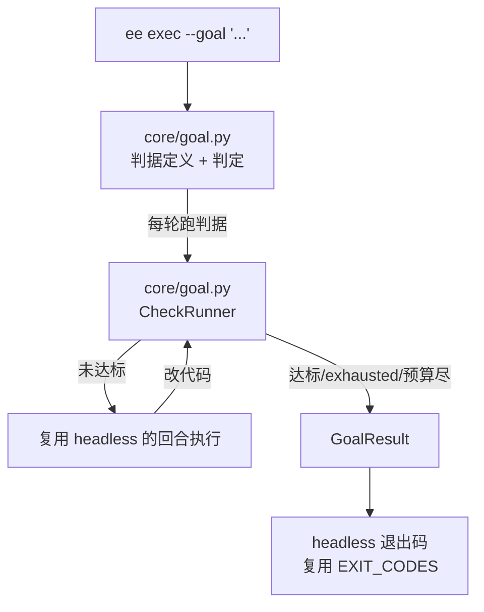

# T10-b：Goal / 检查循环 —— 文件级任务书

> 来源：`research\plans\2026-10-28-stabilization-and-d6.md` 的「Wave 5 / T10」，
> 其中「Goal/检查循环：复用 Thread 生命周期和权限执行入口，抽取有限续跑控制器，
> 不复制另一个 Agent 循环」一项。**本文件只覆盖这一项。**
>
> 授权边界：本轮用户说「先不做桌面端，先做其他的」。本文含后端与 CLI，不含桌面端 UI。

## 需求提炼

目标：让 agent 能"跑到满足条件为止"——用户给一个可判定的完成条件（如"测试全绿"），
agent 反复尝试，达标就停，没达标且预算用完也要停，并把"为什么停"如实报出来。

非目标：不做定时调度（`/loop` 已有）、不做多候选择优（best-of-n 另立项）、
不做桌面端 UI、不复刻第二个 agent 循环、不做自动恢复破坏性动作。

## 取证：为什么这项不是重复建设

| 现有能力 | 实测事实 | 锚点 |
|---|---|---|
| `/loop` | 只解析**时间间隔**（秒/分/时/天），周期性重复，**没有完成判据** | `core\loopspec.py:19` `DEFAULT_MINUTES=10`、`:39` `_UNIT` |
| `ee exec` | 有完整退出码体系：0 完成 / 3 步数上限 / 4 防死循环 / 5 花费上限 / 130 中断 | `headless.py:46` `EXIT_CODES`、`:18-24` 文档 |
| `ee exec` 的停止 | **单回合**：一次 start_turn 到底就退出，不会"再来一轮直到达标" | `headless.py` 的 `run()` 结构 |

所以缺的正是"条件驱动 + 多轮续跑 + 判据判定"这一层，且它必须**建立在已有退出码与预算体系之上**，
不另造一套。这正是计划原文"复用线程生命周期和权限执行入口，抽取有限续跑控制器"的意思。

## 目标（用户可观察）

给一个确实失败的条件（如"测试通过"而测试当前是红的），agent 会尝试修改；
修好后再判一次，达标就停并报 `met`；如果到轮次上限仍未达标，报 `exhausted` 并说明最后
一次判据的实际输出。给一个一上来就成立的条件，它**不做任何修改**就报 `met`（零轮跑完）。

不算完成的替代物：命令跑过了、退出码是 0 但没有任何测试被收集、判据字符串能被序列化。

## 架构

分层理由：`core/goal.py` 只负责**判据的定义与判定**（纯判定 + 一次子进程执行），
不负责跑 agent 回合——那部分复用 `headless.run()`。这样判据逻辑能单独测，
也不会出现"第二个 agent 循环"。

## 不变量

1. **零测试不算成功。** 判据要求"有效测试数量 > 0"，命令退出码 0 但一条测试没收集到
   （`collected 0 items` / `no tests ran`）必须判为**未达标**。这是本项目已经踩过的坑。
2. **超时不是成功。** 判据命令超时 → 未达标，并记录 `timeout`。
3. **未跑完不算成功。** 命令被杀、被中断、没拿到退出码 → 未达标。
4. **先判后跑。** 第一轮开始前先判一次：条件本来就成立时不做任何修改（避免无谓改动）。
5. **默认有限预算。** 轮次上限、总时长、花费上限三者都有默认值，且都可通过参数收紧。
6. **中断是独立终态。** 用户 Ctrl+C 得到 `interrupted`，不是 `exhausted`；不复用。
7. **重启不自动恢复。** 破坏性动作不因重启被重放（沿用既有会话语义）。
8. **判据只由用户给。** 模型不能自己改判据——否则它会让"测试通过"变成"不用测"。

---

## U1：判据类型与判定（`ee\ee\core\goal.py`）

**职责**：定义判据、执行一次判定、给出可复核的结论。不含 agent 回合。

### 实施要点

- 判据结构：`{kind: "command", command: str, cwd: str|None, min_tests: int = 1, timeout: float}`。
  MVP 只做 `command` 一种；不做自然语言判据（无法可靠判定 → 假成功风险）。
- `judge(spec, cwd) -> Verdict`，`Verdict = {met: bool, reason: str, exit: int|None,
  tests_collected: int|None, duration: float, output_tail: str}`。
- **有效测试数量**：从 pytest 输出里解析 `N passed` / `N items` / `collected N items`；
  解析不到就按 0 处理（宁可判未达标，不可假成功）。
- `min_tests` 默认 1：`exit=0` 但 `tests_collected=0` → `met=False, reason="zero_tests"`。
- 超时 → `met=False, reason="timeout"`。
- 执行用项目既有的命令执行入口（与 shell 工具同一条路），不新开 `subprocess` 语义。

### RED 测试（`ee\tests\test_goal.py`）

| 测试 | 断言 |
|---|---|
| `test_exit_zero_with_zero_tests_is_not_met` | `collected 0 items` + exit 0 → met=False, reason 含 zero |
| `test_exit_zero_with_tests_is_met` | `3 passed` + exit 0 → met=True |
| `test_nonzero_exit_is_not_met` | exit 1 → met=False |
| `test_timeout_is_not_met` | 超时 → met=False, reason 含 timeout |
| `test_unparsable_output_with_zero_exit_not_met` | 输出里没有测试计数 + exit 0 → met=False（不假成功） |
| `test_min_tests_honored` | `min_tests=3` 而只收集到 2 个 → met=False |

---

## U2：续跑控制器（`ee\ee\core\goal.py` + `headless.py` 接入）

**职责**：先判一次；未达标就跑一个 agent 回合；再判；直到达标或预算耗尽。

### 实施要点

- `run_goal(spec, budget, turn_runner) -> GoalResult`，`turn_runner` 由调用方注入
  （headless 传它自己的回合执行），**这样不是第二个 agent 循环**。
- 轮次上限默认 3，总时长默认 10 分钟，花费上限沿用现有 `BudgetGuard`。
- 每轮结束记录：第几轮、判定结果、耗时、token；进最终报告。
- 停止原因：`met` / `exhausted`（轮次用完）/ `budget` / `interrupted` / `error`。
- 首轮判定即达标 → 轮次为 0，不做任何 turn。
- 最终报告必须含**最后一次判据的 output_tail**，让人能自己复核为什么没达标。

### RED 测试

| 测试 | 断言 |
|---|---|
| `test_met_first_check_runs_no_turn` | 条件本来就成立 → turn 调用次数为 0 |
| `test_runs_turn_until_met` | 第 2 次判定成立 → 只跑 1 个 turn |
| `test_exhausted_after_max_rounds` | 一直不成立 → 跑满上限后报 exhausted |
| `test_budget_stop_reason` | 花费超限 → stop_reason=budget，不是 exhausted |
| `test_report_includes_last_output` | 报告里有最后一次判据的输出片段 |
| `test_zero_tests_never_counts_as_met` | 判据永远零测试 → 不允许报 met |

---

## U3：CLI 接入（`ee\ee\cli.py` + `headless.py`）

**职责**：`ee exec --goal "<命令>"`。

- `--goal` 与 `--goal-max-rounds` / `--goal-timeout` / `--goal-min-tests`。
- 退出码复用 `EXIT_CODES`：`met`→0；`exhausted`→3（与步数上限同义：预算耗尽）；
  `budget`→5；`interrupted`→130；`error`→1。
- `--json` 模式下每轮判据输出一条事件，末行 `turn_done` 带 `stop_reason`。
- 与 `--max-steps` 并存时不冲突：每轮 turn 受 max-steps 约束，goal 管轮次。

### RED 测试（`ee\tests\test_goal_cli.py`）

| 测试 | 断言 |
|---|---|
| `test_goal_flag_registered` | `--goal` 出现在 exec 的参数里 |
| `test_goal_met_exit_zero` | 条件成立 → 退出码 0 |
| `test_goal_exhausted_exit_three` | 不成立 → 退出码 3 |
| `test_goal_json_emits_per_round_events` | `--json` 时每轮都有事件 |

## Wave 分批

| Wave | 单元 | 停点 |
|---|---|---|
| A | U1 | `test_goal.py` 的判定用例全绿；零测试/超时/无法解析三种都判未达标 |
| B | U2 | 续跑用例全绿；首轮达标零 turn、耗尽报 exhausted、预算报 budget |
| C | U3 | CLI 用例全绿 + `test_exec.py` 回归不破 |

## 验收（唯一标准）

> 给一个当前失败的判据（如 `pytest -q` 而测试是红的），agent 会尝试修复；修好后再判，
> 达标报 `met` 退出 0；到轮次上限仍未达标报 `exhausted` 退出 3 并附最后一次输出；
> 判据命令 exit 0 但零测试收集时**不报成功**。

## 明确不做

- 不做桌面端 UI（用户本轮明确"先不做桌面端"）。
- 不做自然语言判据（无法可靠判定，假成功风险高于价值）。
- 不做定时触发（`/loop` 已有，两者正交）。
- 不做多候选择优（best-of-n 另立项）。
- 不新建 agent 循环，`turn_runner` 由调用方注入。

## 待确认 / 风险

- **判据命令的权限**：goal 判据会在无人值守下反复执行。必须走既有的命令审批/沙箱路径，
  不能因为"这是判据"就放行。实施 U1 时先确认复用点。
- **测试计数解析**：pytest / vitest / go test 输出格式不同。MVP 只保证 pytest 与
  "解析不到就当 0"；其它框架解析不到时会一直判未达标——这是**保守方向**，
  会表现为"跑满轮次后 exhausted"，不会假成功。
- 本机没有 `vitest` 判据的真实用例，U3 的端到端只能用 pytest 验。
